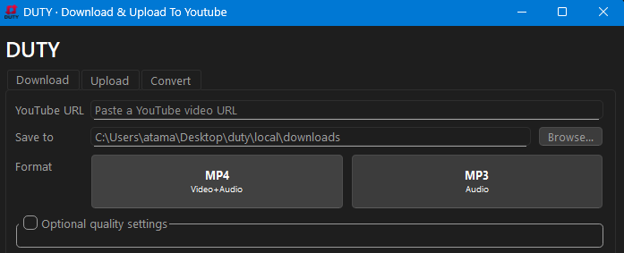
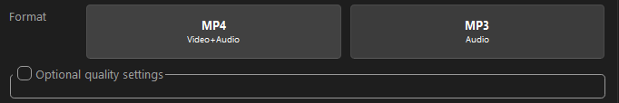
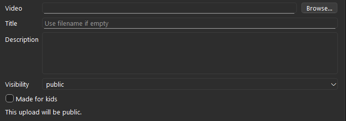
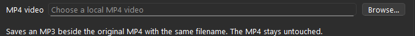
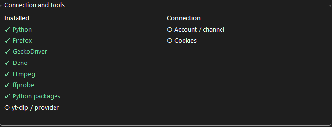

<p align="center">
  
</p>

<h3 align="center">Download & Upload To YouTube</h3>

<p align="center">
  
  
  
</p>

DUTY is a small Windows app that does three things: it **downloads** YouTube
videos (as MP4 or MP3), **uploads** your own videos to your channel, and
**converts** MP4 files you already have into MP3s.

You can use it through a simple desktop window, or automate it from the command
line if you'd rather script things. There are no API keys to set up and no
third-party services involved. It signs in to YouTube through a real Firefox
window, just like you would.

<p align="center">
  
</p>

## Getting started

DUTY comes with its own Python 3.11.9 x64, Python libraries, Firefox,
GeckoDriver, FFmpeg, Deno and provider dependencies. You don't need to install
Python, pip or any other tool, and there is no installation setup.
Use Windows 10 or 11 x64 and extract the complete folder somewhere writable.

1. Download the repository as a ZIP and extract it, or clone it with Git LFS:

   ```bash
   git lfs install
   git clone https://github.com/Eianex/duty.git
   ```

   For an existing clone, run `git lfs pull` to get the bundled binary files.

2. Double-click **`DUTY.exe`**. It checks the bundled files locally and opens
   the app. No terminal or installation window is needed.

3. The first time you download or upload, DUTY opens Firefox and asks you to sign
   in to Google. Complete any verification prompts and select your channel.
   DUTY saves that session. Local MP4-to-MP3 conversion needs no login or internet.

The complete extracted download is approximately 1.5 GB. Keep the entire folder
together when moving it. Updates include the required tools; DUTY doesn't
download or silently upgrade its dependencies. Your saved login and history are
separate from those bundled files.

<details>
<summary>If DUTY reports missing or incomplete files</summary>

Restore the missing files from a complete DUTY download. A Git LFS pointer is a
small placeholder, not the executable: run `git lfs pull` in a Git clone.
There is no `setup` command or automatic installation fallback.

For repository maintainers: enable **Include Git LFS objects in archives** in
GitHub's repository settings before publishing ZIP downloads. Otherwise those
downloads contain placeholders instead of the tools. Git LFS storage and
download quotas apply. Run `git lfs install` inside this repository before your
first commit/push of the bundled files, so Git LFS can upload the binary objects.

</details>

## Using the app

The window has three tabs. Only one job runs at a time, and you can cancel it
from the button below the form.

### Download

Paste a YouTube link, pick where to save it, and choose a format.
**MP4** gets the best video and audio YouTube has, without re-encoding. **MP3**
grabs the best audio and turns it into an MP3. If you need an exact resolution,
open **Optional quality settings** and pick 1080p or 4K. The download fails
instead of quietly giving you something smaller.

<p align="center">
  
</p>

By default, files go to `local/downloads/`. If a download gets interrupted, running
it again with the same options picks up where it left off.

### Upload

Pick an MP4 or MKV, give it a title (or leave it empty to use the filename), a
description, a visibility and an audience. Uploads are **public** and **not made
for kids** unless you change them, and the window always tells you which
visibility you're about to use.

<p align="center">
  
</p>

### Convert

Choose an MP4 on your computer and DUTY saves an MP3 next to it with the same
name. Your original file isn't changed, and an existing MP3 is never replaced.
This works offline and doesn't need a YouTube login.

<p align="center">
  
</p>

### The status panel

At the bottom, DUTY checks its tools and your saved login when it starts. A green
✓ means the check passed, ○ means it's still checking or needs your attention,
and ✕ means something failed. **Refresh login** reopens Firefox if you ever
need to sign in again.

<p align="center">
  
</p>

A green panel means the local checks passed. It can't promise YouTube won't throw a
bot check at you later.

## Using the command line

Everything the window does is also available as a command, which is handy for
scripts, scheduled tasks or other tools.

| What you want | Command |
|---|---|
| Sign in (or refresh the login) | `local/runtime/python/python.exe src/main.py login` / `login --refresh` |
| Check that everything is ready | `local/runtime/python/python.exe src/main.py status` |
| Download a video | `local/runtime/python/python.exe src/main.py download "URL"` |
| Download audio only | `local/runtime/python/python.exe src/main.py download "URL" --format mp3` |
| Convert an MP4 to MP3 | `local/runtime/python/python.exe src/main.py convert "clip.mp4"` |
| Upload a video | `local/runtime/python/python.exe src/main.py upload "clip.mp4" --title "My video"` |
| See past transfers | `local/runtime/python/python.exe src/main.py history` |

A few more options:

```bash
local/runtime/python/python.exe src/main.py download "URL" --output "D:\Videos" --exact-1080
local/runtime/python/python.exe src/main.py download "URL" --exact-4k
local/runtime/python/python.exe src/main.py convert "clip.mp4" --overwrite
local/runtime/python/python.exe src/main.py upload "clip.mkv" --visibility private --description "Behind the scenes"
local/runtime/python/python.exe src/main.py status --online
```

Run `local/runtime/python/python.exe src/main.py --help` (or `--help` after any command) to see everything.

### Upload details from a file

Instead of passing the title and description on the command line, you can put a
`metadata.json` next to the video (or point to one with `--metadata PATH`):

```json
{"title": "My video", "description": "", "visibility": "public", "made_for_kids": false}
```

Command-line options win over the file, and the file wins over `settings.toml`.
Use `--made-for-kids` / `--no-made-for-kids` to set the audience, and
`--headless` to hide the upload browser. The login window is always visible.

### Automating it

Add `--json` for machine-readable output and `--non-interactive` so DUTY never
pops up a login window in the middle of a script:

```bash
local/runtime/python/python.exe src/main.py --json --non-interactive download "URL"
```

The JSON result goes to stdout and progress goes to stderr. Exit codes are
`0` success, `1` failure (or an upload that couldn't be confirmed), `2` login
needed and `130` cancelled.

## Using it from Python

If you'd rather call DUTY from your own script, put the script in the project
folder (or add the folder to your import path), run it with
`local/runtime/python/python.exe your_script.py`, and use the same helpers the app uses:

```python
from src.core import Config
from src.download import download_video, convert_video
from src.upload import upload_video

config = Config()
config.non_interactive = True

result = download_video("https://www.youtube.com/watch?v=VIDEO_ID", config=config)
print(result.to_dict())

# convert_video("clip.mp4", config=config)
# upload_video("clip.mkv", config=config, title="My video", visibility="private")
```

`config.on_event` receives progress updates, and `config.cancel_event.set()`
asks the current job to stop.

## Where your stuff lives

- **`settings.toml`** has the upload defaults (visibility, audience, headless)
  and a few timeouts. It's the only config file.
- **`local/runtime/`** and **`local/provider/server/`** contain the bundled tools
  and libraries. These public dependency files are included in Git.
- Other **`local/`** folders hold your saved login, cookies, downloads, history
  and working caches. These private and generated files stay ignored by Git.

You can move the whole folder somewhere else and it keeps working. Don't share
your `local/` folder with anyone, though, because it's signed in to your account.
If you manage more than one channel, use a separate copy of DUTY for each.

## If an upload gets stuck

Occasionally YouTube Studio doesn't clearly confirm that an upload finished.
When that happens, DUTY marks the upload as *unresolved* and refuses to upload
the same file again, so you never end up with a duplicate video. It also happens
if you cancel or close the window after the file has started uploading.

Check your channel in YouTube Studio, then tell DUTY what happened:

```bash
local/runtime/python/python.exe src/main.py history --resolve upload_JOB_ID --status completed --video-id VIDEO_ID
```

If you're sure no video was created, use `--status failed` instead. That lets you
try the upload again.

## What it doesn't do (yet)

DUTY handles one video at a time. It doesn't do playlists, batches, search,
scheduled uploads, thumbnails, tags, playlist management or editing videos that
are already on your channel.

> **Heads-up:** If something looks off, please open an issue.

## Credits & licenses

DUTY's own code is [MIT licensed](LICENSE). It stands on the shoulders of
[yt-dlp](https://github.com/yt-dlp/yt-dlp), FFmpeg, Firefox, GeckoDriver, Deno,
PySide6 and the [BgUtils PO-token provider](https://github.com/Brainicism/bgutil-ytdlp-pot-provider),
which keep their own licenses (BgUtils is GPL-3.0). See
[THIRD_PARTY.md](THIRD_PARTY.md) for the full details.

Working on the code? [AGENTS.md](AGENTS.md) and
[`.agents/docs/project.md`](.agents/docs/project.md) explain how the project is put together.
